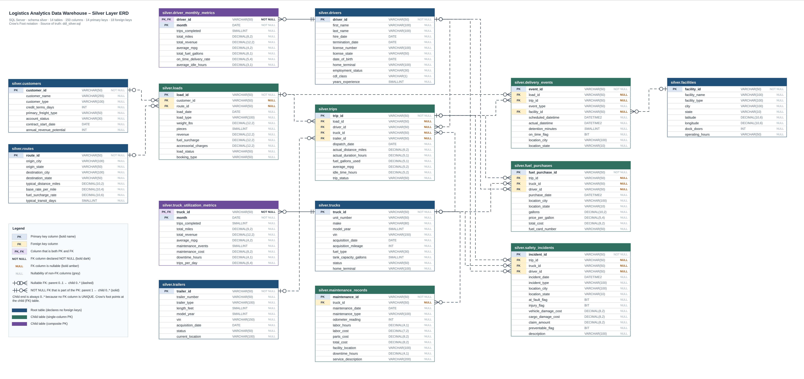
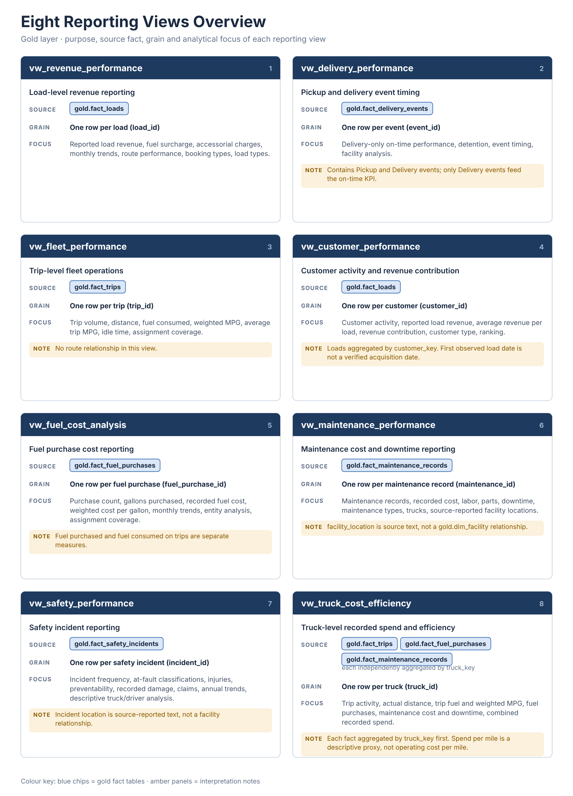
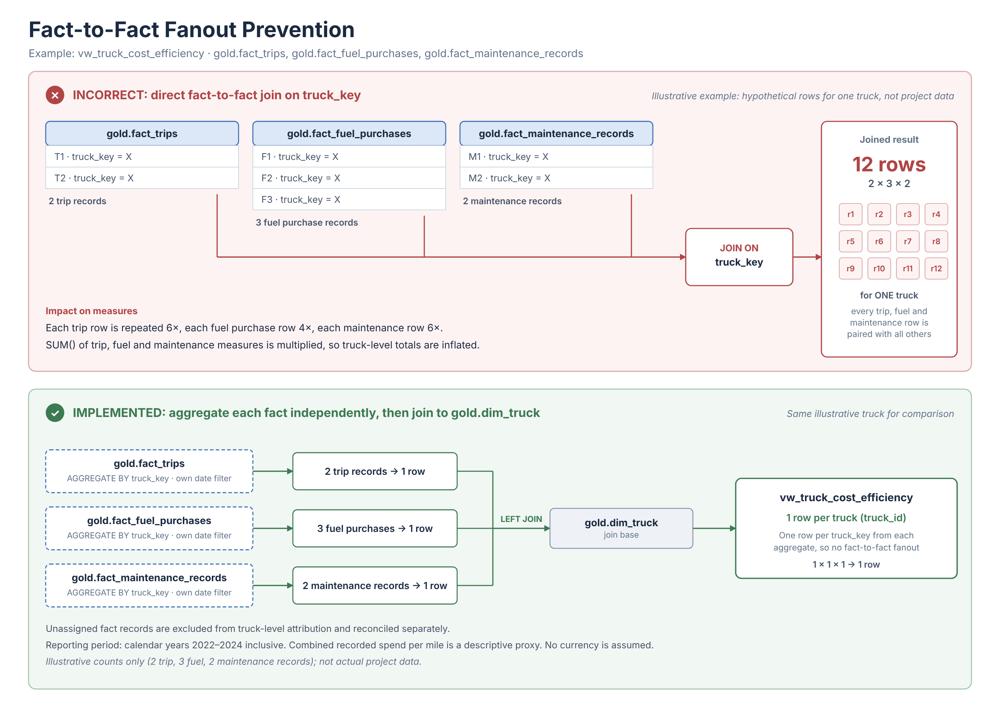

# Logistics Analytics Data Warehouse

**A SQL Server analytics platform built with the Medallion Architecture — from raw logistics data to validated dimensional models and business-ready reporting views.**

[Repository](https://github.com/hamzaa-rehman/logistics-analytics-data-warehouse) · [Gold validation evidence](docs/gold/gold_validation.md) · [Gold reporting views](docs/gold/gold_reporting_views.md) · [Gold data dictionary](docs/gold/gold_data_dictionary.md)

---

## Project at a glance

| | |
|---|---:|
| Source tables | **14** |
| Source records ingested | **549,706** |
| Source columns | **150** |
| Warehouse layers | **Bronze · Silver · Gold** |
| Gold dimensions | **7** |
| Gold fact tables | **6** |
| Gold reporting views | **8** |
| Gold fact records reconciled | **541,172** |
| Gold FK relationships checked | **18 / 18 passed** |

This project takes a multi-table logistics operations dataset and develops it into a structured SQL Server warehouse that can support consistent analysis of loads, delivery performance, fleet activity, customers, fuel purchases, maintenance, and safety.

The work covers more than loading tables. It includes source profiling, data-quality investigations, relational modelling, explicit transformation rules, dimensional design, grain-aware reporting, and repeatable validation and reconciliation.

> **Reporting boundary:** The SQL warehouse and eight Gold reporting views are implemented. The Power BI semantic model and dashboards are the next consumption layer; they are not represented as completed deliverables in this repository.

## Business problem

Logistics operations generate related but different types of data: customer and load records, trips, pickup and delivery events, fuel purchases, vehicle maintenance, and safety incidents. When these records are stored in separate operational tables or flat files, it is difficult to produce consistent management reporting.

Several issues must be resolved before the data can be trusted for analysis:

- **Different levels of detail:** one load, one trip, two delivery events, one fuel purchase, and one maintenance record are not interchangeable reporting units.
- **Inconsistent source representation:** dates, timestamps, numeric values, identifiers, and descriptive categories arrive as raw text and need controlled interpretation.
- **Incomplete operational assignments:** some trips have no recorded truck, driver, or trailer assignment; missing relationships must not be disguised as valid assignments.
- **Risk of duplicated measures:** joining multiple fact tables directly can multiply rows and inflate revenue, distance, fuel, or cost totals.
- **Ambiguous KPI definitions:** pickup events must not be included in the on-time delivery denominator; fuel purchased must remain distinct from fuel consumed; partial reporting periods need qualification.
- **Limited business context:** a numeric field should not be labelled as utilization, profitability, or acquisition without evidence that its definition supports that interpretation.

The project addresses these problems by separating raw ingestion, standardized relational data, and business-oriented analytical models—and by documenting the assumptions and limitations that remain.

## Solution and architecture

The warehouse follows a three-layer Medallion Architecture.

| Layer | Responsibility | Implementation |
|---|---|---|
| **Bronze** | Preserve source data as ingested | 14 raw tables; 549,706 rows; 150 columns stored as VARCHAR; full-refresh loading; metadata-driven profiling |
| **Silver** | Standardize and establish relational integrity | 14 typed tables; 549,706 rows; explicit conversions and mappings; 14 primary keys; 18 foreign keys; transactional full-refresh load |
| **Gold** | Organize data for analytical consumption | 7 dimensions; 6 fact tables; surrogate keys; role-playing date relationships; 8 reporting views |

Bronze retains the original textual representation for traceability. Silver applies approved data types and targeted standardization while preserving source entity grain. Gold organizes business processes into facts and descriptive dimensions, then exposes reusable reporting datasets.

## Source data

The project uses the **Logistics Operations Database** dataset, identified in the project materials as a Kaggle dataset. The repository contains 14 CSV files covering:

| Subject area | Source tables |
|---|---|
| Master data | Customers, drivers, trucks, trailers, facilities, routes |
| Core operations | Loads, trips, delivery events |
| Cost and asset operations | Fuel purchases, maintenance records |
| Risk and performance | Safety incidents, driver monthly metrics, truck utilization metrics |

The data contains 549,706 records across 150 columns. Operational activity primarily spans **1 January 2022 to 31 December 2024**. Delivery-event and fuel-purchase records extend into **January 2025**, but January is partial and must not be treated as a complete month.

- [Dataset directory and source-to-table mapping](datasets/README.md)
- [Source CSV files](datasets/logistics_operations_database/)
- [Bronze profiling configuration](datasets/profiling_config/bronze_profiling_config.csv)
- [Bronze data inventory workbook](docs/data_inventory/Logistics_Data_Inventory_Bronze.xlsx)

## Bronze — ingestion, preservation, and profiling

Bronze is deliberately simple: the 14 source tables are loaded into SQL Server with all 150 columns represented as VARCHAR. No business cleaning, deduplication, or type conversion is applied at this stage. The full-refresh load truncates and reloads each table from its mapped CSV file.

A metadata configuration classifies every source column into one of six profiling groups:

| Profiling group | Columns |
|---|---:|
| CATEGORY | 39 |
| NUMERIC | 53 |
| IDENTIFIER | 36 |
| DATE | 11 |
| DATETIME | 4 |
| TEXT | 7 |
| **Total** | **150** |

Reusable profiling scripts assess completeness, distinct values, distributions, conversion feasibility, numeric ranges, text lengths, and date/time boundaries. Separate investigations examine issues that require business interpretation rather than a simple profile.

Documented investigations include delivery detention and the on-time flag, delivery KPI definition, geographic consistency, identifier integrity, utilization-rate interpretation, safety-incident financial fields, and January 2025 timestamp alignment across fuel purchases and delivery activity.

**Why this matters:** profiling informs downstream design decisions. A value is not converted, renamed, merged, or reinterpreted merely because a different representation looks more convenient.

- [Bronze layer documentation](docs/bronze/readme.md)
- [Profiling reports and investigation write-ups](docs/bronze/)
- [Bronze SQL scripts](scripts/bronze/)

## Silver — typed, standardized relational data

Silver converts the raw VARCHAR representation into explicit SQL Server data types while preserving the source table structure and record grain.

The layer contains the same **14 tables and 549,706 records** as Bronze. Every table has a primary key. Twelve use a single-column primary key, while the two monthly metric tables use composite keys to enforce their intended driver/month and truck/month grains. The relational model declares 18 foreign keys, all documented as enabled and trusted.

Key implementation choices include:

- Identifiers remain character values so leading zeros and identifier semantics are preserved.
- Calendar dates use DATE; event timestamps use DATETIME2.
- Numeric fields use explicit integer or DECIMAL(p,s) definitions.
- Target columns and source mappings are listed explicitly rather than relying on SELECT * or column order.
- Trimming and blank-to-NULL handling are applied selectively, particularly to identifiers and nullable relationships.
- Strict conversions fail the transactional load rather than silently turning invalid non-empty values into NULL.
- Source records are not deduplicated and missing business relationships are not fabricated.

Investigations informed specific mappings. For example, the source utilization field was determined to behave as **trips per calendar day**, not a utilization percentage; it is represented in Silver as trips_per_day. The approved type for customers.annual_revenue_potential is INT.

- [Silver layer documentation and table inventory](docs/silver/readme.md)
- [Silver DDL](scripts/silver/ddl_silver.sql)
- [Silver full-refresh load procedure](scripts/silver/load_silver.sql)
- [Silver reset script](scripts/silver/reset_silver.sql)
- [Silver validation SQL](tests/validate_silver.sql)

## Gold — dimensional model

Gold converts the standardized relational layer into a dimensional model organized around business processes. The model contains **seven dimensions and six fact tables**.

### Dimensions

| Dimension | Analytical purpose |
|---|---|
| dim_customer | Customer identity and descriptive attributes |
| dim_date | Calendar, reporting-period, and ISO week attributes |
| dim_driver | Driver identity and descriptive attributes |
| dim_facility | Facility identity and location attributes |
| dim_route | Route identity, endpoints, and typical distance |
| dim_trailer | Trailer identity and descriptive attributes |
| dim_truck | Truck identity and descriptive attributes |

### Facts and their grains

| Fact table | Grain — one row per |
|---|---|
| fact_loads | Load |
| fact_trips | Trip |
| fact_delivery_events | Pickup or delivery event |
| fact_fuel_purchases | Fuel purchase |
| fact_maintenance_records | Maintenance record |
| fact_safety_incidents | Safety incident |

The six facts contain **541,172 records** in total. Each fact retains its source business identifier and has a surrogate primary key. Dimension keys connect facts to descriptive context; optional source assignments remain nullable where appropriate.

### Modelling decisions that protect analytical correctness

- **Facts remain separate:** loads, trips, delivery events, fuel purchases, maintenance, and incidents represent different business processes and grains. They are not flattened into one wide fact table.
- **No fact-to-fact foreign keys:** identifiers such as load_id and trip_id may be retained for traceability, but the model does not treat one fact table as a dimension for another.
- **Date roles are explicit:** delivery events use separate scheduled-date and actual-date relationships to dim_date.
- **Optional assignments stay optional:** missing truck, driver, or trailer assignments are not replaced with invented dimension keys.
- **Route belongs to loads:** the source trip table has no route_id; the model does not fabricate a trip-to-route relationship.
- **Source locations remain distinct:** event-reported location text is not overwritten with facility master location.
- **Calendar and ISO week-year are distinct:** year_number represents calendar year, while iso_week_year supports correct ISO weekly grouping across year boundaries.

The date dimension contains **5,114 dates**, covering **2012-01-01 through 2025-12-31**.

- [Gold DDL](scripts/gold/ddl_gold.sql)
- [Gold full-refresh load procedure](scripts/gold/load_gold.sql)
- [Gold data dictionary and source-to-target mapping](docs/gold/gold_data_dictionary.md)
- [Gold relationship investigations and modelling decisions](docs/gold/gold_relationship_investigations.md)

## Gold reporting layer — eight analytical views

Eight subject-specific views expose the dimensional model through business-oriented datasets. Each view has a defined grain and documented join strategy.

| Reporting view | Grain | Business use |
|---|---|---|
| vw_revenue_performance | One row per load | Reported revenue, load characteristics, customer and route analysis |
| vw_delivery_performance | One row per event | Pickup and delivery activity, delivery-only on-time KPI, detention |
| vw_fleet_performance | One row per trip | Distance, fuel consumption, MPG, idle time, driver and truck context |
| vw_customer_performance | One row per customer | Customer activity and reported revenue contribution |
| vw_fuel_cost_analysis | One row per fuel purchase | Purchased gallons, recorded fuel cost, unit price, assignment analysis |
| vw_maintenance_performance | One row per maintenance record | Maintenance activity, recorded cost, labour, downtime |
| vw_safety_performance | One row per incident | Incident classification, injury, preventability, recorded damage |
| vw_truck_cost_efficiency | One row per truck | Independently aggregated trip, fuel, and maintenance comparisons |

### Preventing fact-table fanout

A central reporting safeguard is preventing measures from being multiplied when facts with different grains are combined. The truck-level cost view independently aggregates trips, fuel purchases, and maintenance records by truck before joining those summaries to the truck dimension. Customer reporting similarly aggregates load measures to customer grain before joining the customer dimension.

The views are not interchangeable datasets. A load-level revenue measure, trip-level distance measure, event-level delivery measure, and purchase-level fuel measure must be aggregated to a common, valid grain before they are compared or combined.

- [Reporting view specifications, grains, joins, definitions, and limitations](docs/gold/gold_reporting_views.md)
- [Eight view SQL definitions](scripts/gold/views/)

## Business questions and analytical findings

The project investigates operational questions and records the resulting definitions and limitations so downstream reporting does not present unsupported interpretations as facts.

### Delivery performance

**Definition:** On-Time Delivery Rate = on-time Delivery events ÷ all Delivery events. Pickup events are excluded from both numerator and denominator.

| Complete year | Delivery events | On-time deliveries | On-time rate |
|---|---:|---:|---:|
| 2022 | 28,489 | 12,730 | 44.68% |
| 2023 | 28,178 | 12,555 | 44.56% |
| 2024 | 28,657 | 12,783 | 44.61% |

The reviewed full-year results show a stable on-time delivery rate of approximately 44.6%. January 2025 contains 86 delivery events and is partial; its 39.53% observed rate must not be compared with full years as though it represented a complete period.

The investigation also observed that events marked on time generally fell within an approximate ±120-minute detention window. This is an observed association in the supplied data—not proof of causation and not an independently established contractual threshold.

### Revenue and customer concentration

- The dataset contains **85,410 loads**, all with a recorded revenue value.
- Total reported load revenue is **262,525,800.29** in source currency units; the currency is not confirmed.
- Fuel surcharge and accessorial charges are retained as separate measures. The source does not establish whether they are already included in reported revenue, so they are not automatically added to create a new “total revenue” measure.
- All **200 customers** are represented in load activity. The top 20 customers account for **11.20%** of reported load revenue.

### Fleet and fuel

- The 85,410 trips include **1,672 trips without a recorded truck assignment**. These remain visible as unassigned rather than being allocated to an assumed vehicle.
- Weighted fleet MPG, calculated as total trip distance divided by total trip fuel, is approximately **6.448**. This is distinct from averaging row-level MPG values.
- Fuel purchases total **24,519,037.80 gallons** and **95,592,992.04** in recorded source cost units. Fuel purchased is not treated as the same measure as fuel consumed on trips.
- **2,478 fuel purchase records** have a one-cent difference between recorded total cost and the rounded gallons-times-unit-price calculation. The recorded source total is preserved.

### Maintenance and safety

The source contains **2,920 maintenance records** and **170 safety incidents**. The project retains their natural event grains and investigates costs, downtime, incident categories, injuries, preventability, and recorded damage fields without combining unrelated amounts or asserting unsupported causes.

### Limits on what the data can establish

- A true fleet utilization percentage is not calculated because a reliable available-time or capacity denominator is not supplied.
- Customer acquisition dates cannot be established from first observed loads; the available load history begins later than some customer contract dates.
- A truck-level recorded-spend-per-mile comparison is a descriptive proxy, not verified operating cost per mile or profitability.
- The source currency is not confirmed; monetary values are therefore shown without a currency symbol.
- January 2025 delivery and fuel records are partial-period data.
- Missing operational assignments and differences between event and facility locations remain explicit analytical caveats.

The full query results, KPI definitions, investigation notes, and decision history are maintained in [Gold KPI investigations](docs/gold/gold_kpi_investigations.md).

## Validation and reconciliation

Validation is treated as a separate engineering responsibility, not an assumption that successful loading means correct data. The repository includes repeatable SQL for Bronze, Silver, and Gold checks, alongside written records of the tested scope and outcomes.

### Gold validation evidence

| Validation area | Executed result |
|---|---:|
| Gold tables with enabled primary keys | 13 / 13 |
| Primary keys are single-column | 13 / 13 |
| Fact-to-dimension relationships checked for orphan rows | 18 / 18; zero orphan rows |
| Foreign keys enabled and trusted | 18 / 18 |
| Source-backed dimension row counts reconciled | 6 / 6 |
| Fact business keys unique and non-NULL | 6 / 6 |
| Silver-to-Gold fact row counts reconciled | 6 / 6 |
| Fact records covered by row-count reconciliation | 541,172 |
| Selected measures reconciled row by row | 6 / 6 fact tables; zero mismatches |
| Date dimension | 5,114 dates; zero tested ISO week-year mismatches |

Measure reconciliation uses source business identifiers, checks for records missing from either side, and compares selected measures row by row. It establishes preservation of those selected values from Silver to Gold; it does not claim that every descriptive attribute or every upstream business calculation has been independently proven correct.

- [Gold validation record and detailed results](docs/gold/gold_validation.md)
- [Gold validation SQL](scripts/gold/validate_gold.sql)
- [Silver-to-Gold measure reconciliation SQL](scripts/gold/reconcile_gold_measures.sql)
- [Bronze validation SQL](tests/validate_bronze.sql)
- [Silver validation SQL](tests/validate_silver.sql)

## Technology

| Technology | Role |
|---|---|
| **Microsoft SQL Server** | Relational database and warehouse platform |
| **T-SQL** | DDL, ingestion procedures, transformations, profiling, investigations, views, and validation |
| **DBeaver** | SQL development and execution environment |
| **Docker** | Local SQL Server development environment |
| **Git and GitHub** | Version control, project history, and technical documentation |
| **Draw.io** | Warehouse architecture and entity-relationship diagrams |
| **Excel** | Source data inventory and profiling workbook |
| **Power BI** | Planned downstream semantic model and dashboard layer |

## Repository guide

The repository is organized by data layer and project responsibility.

~~~text
logistics-analytics-data-warehouse/
├── datasets/
│   ├── logistics_operations_database/   # 14 source CSV files
│   └── profiling_config/                # Bronze column classifications
├── docs/
│   ├── bronze/                          # Profiling reports and investigations
│   ├── data_inventory/                  # Source inventory workbook
│   ├── diagrams/                        # Architecture, ERDs, reporting diagrams
│   ├── gold/                            # Gold dictionary, KPIs, views, validation
│   └── silver/                          # Silver model and transformation documentation
├── scripts/
│   ├── bronze/                          # Raw DDL, load, profiling, investigations
│   ├── silver/                          # Typed schema, load, reset
│   └── gold/                            # Dimensional DDL, load, validation, views
├── tests/                               # Bronze and Silver validation scripts
├── LICENSE
└── README.md
~~~

### Key implementation files

| Purpose | File |
|---|---|
| Bronze schema | [ddl_bronze.sql](scripts/bronze/ddl_bronze.sql) |
| Bronze ingestion | [load_bronze.sql](scripts/bronze/load_bronze.sql) |
| Bronze profiling configuration | [profiling_config.sql](scripts/bronze/profiling_config.sql) |
| Silver schema | [ddl_silver.sql](scripts/silver/ddl_silver.sql) |
| Silver transformation and load | [load_silver.sql](scripts/silver/load_silver.sql) |
| Gold dimensional schema | [ddl_gold.sql](scripts/gold/ddl_gold.sql) |
| Gold dimensional load | [load_gold.sql](scripts/gold/load_gold.sql) |
| Gold structural validation | [validate_gold.sql](scripts/gold/validate_gold.sql) |
| Gold measure reconciliation | [reconcile_gold_measures.sql](scripts/gold/reconcile_gold_measures.sql) |
| Gold reporting views | [scripts/gold/views/](scripts/gold/views/) |

## Running the project

This repository contains SQL Server scripts and source files; it is not a one-click deployment package. Execution requires a SQL Server instance and a configured source-file location accessible to that instance.

A typical build sequence is:

1. Review the dataset notes and confirm the CSV files are available to SQL Server.
2. Create the Bronze schema and tables using the Bronze DDL.
3. Configure the source folder path in the Bronze load procedure and load the CSV files.
4. Run Bronze validation and profiling; review the documented investigations.
5. Create the Silver schema and tables, then execute the transactional Silver full-refresh load.
6. Run Silver validation.
7. Create the Gold dimensions and facts, then execute the Gold full-refresh load.
8. Create the eight Gold reporting views.
9. Run Gold structural validation and Silver-to-Gold measure reconciliation.
10. Review the reporting-view documentation and KPI caveats before connecting a BI tool.

**Execution precautions**

- Read each script before running it and use the documented execution order.
- The Bronze DDL drops and recreates existing Bronze tables. The Bronze, Silver, and Gold reset scripts are destructive to their respective layers; use them only when a rebuild is intended.
- The Bronze load procedure truncates and reloads its tables one by one and does not wrap all 14 table loads in one transaction. A failure partway through can leave the layer partially refreshed.
- The Silver load is transactional. Review its procedure and error handling before execution.
- Confirm the file path and permissions from the SQL Server service/container perspective. A path on the host machine is not automatically visible inside a Docker container.
- The Gold load is a full refresh. Do not treat these scripts as an incremental or change-data-capture pipeline.
- Database names, schema availability, file paths, and permissions may need to be adapted to the local SQL Server environment.

## Documentation map

For a deeper technical review, these documents provide the evidence behind the implementation:

- [Bronze layer: ingestion and profiling](docs/bronze/readme.md)
- [Silver layer: relational model and transformation decisions](docs/silver/readme.md)
- [Gold data dictionary: columns, keys, and source mappings](docs/gold/gold_data_dictionary.md)
- [Gold relationship investigations](docs/gold/gold_relationship_investigations.md)
- [Gold KPI investigations and business definitions](docs/gold/gold_kpi_investigations.md)
- [Gold reporting view specifications](docs/gold/gold_reporting_views.md)
- [Gold validation and reconciliation record](docs/gold/gold_validation.md)

## Scope and limitations

The warehouse is built for analytical preparation and reporting over the supplied dataset. It is not presented as a live production logistics platform.

The current implementation does not include incremental ingestion, orchestration, automated scheduling, streaming, slowly changing dimension processing, a production deployment pipeline, or a completed Power BI semantic model and dashboard. The two monthly metric source tables are retained in Silver but are not currently modelled as Gold facts because the implemented Gold scope is based on the six investigated operational processes.

The dataset itself has limitations. Some operational assignments are missing; event and facility location fields have different values whose business meaning is not fully established; currency is unspecified; partial January 2025 activity exists; and some proposed business metrics lack the denominators or definitions required for defensible calculation. These limitations are documented rather than hidden or filled with assumptions.

## Source attribution and licence

The source files are identified in this project as the **Logistics Operations Database** dataset from Kaggle. Consult the original dataset listing and its applicable terms before reusing or redistributing the source data. The repository's [MIT License](LICENSE) applies to the project code and documentation to the extent permitted; it does not replace or override the source dataset's licence or usage conditions.

---

**The objective is not simply to store logistics data in SQL Server. It is to make the data traceable, structurally reliable, analytically usable, and transparent about what the available evidence can—and cannot—support.**
