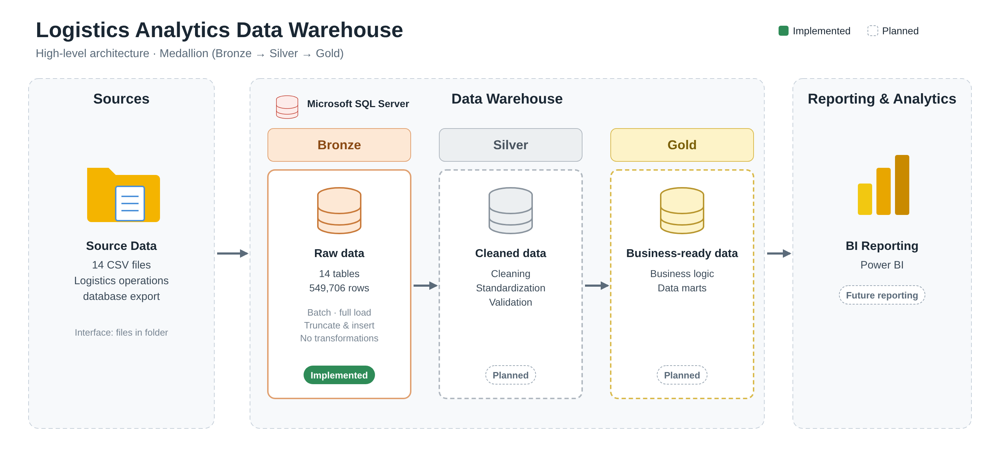

# Bronze Layer — Logistics Analytics Data Warehouse

## 1. Overview

The Bronze layer is the initial ingestion layer of the Logistics Analytics Data Warehouse. Its primary responsibility is to store raw data from the source CSV files while preserving the original textual values without applying data cleaning, standardization, or business transformations.

It provides a foundation for subsequent processing in the Silver and Gold layers and maintains a raw representation of the source data for traceability, validation, and investigation.

### Project scope

| Metric | Result |
|---|---:|
| Source tables | 14 |
| Total records loaded | 549,706 |
| Total columns | 150 |
| Bronze columns stored as | VARCHAR |
| Loading strategy | Full refresh |

**Source dataset:** Kaggle — Logistics Operations Database.

## 2. Data Warehouse Architecture

The project is designed around the Medallion Architecture, separating data ingestion, data transformation, and business-level modelling into three layers. The Bronze layer has been implemented; the Silver and Gold layers represent the planned next stages.



*Figure 1: High-level architecture of the Logistics Analytics Data Warehouse.*

Each layer has a clearly defined responsibility:

- **Bronze:** Preserves raw source data.
- **Silver:** Cleans, standardizes, validates, and converts data into appropriate data types.
- **Gold:** Applies business logic and prepares analytical datasets for reporting and decision-making.

This separation makes the pipeline modular, maintainable, easier to troubleshoot, and easier to extend.

## 3. Source Data Inventory

The Bronze layer contains 14 source tables.

| Source table | Loaded rows |
|---|---:|
| CUSTOMERS | 200 |
| DRIVERS | 150 |
| TRUCKS | 120 |
| TRAILERS | 180 |
| FACILITIES | 50 |
| ROUTES | 58 |
| LOADS | 85,410 |
| TRIPS | 85,410 |
| FUEL_PURCHASES | 196,442 |
| MAINTENANCE_RECORDS | 2,920 |
| DELIVERY_EVENTS | 170,820 |
| SAFETY_INCIDENTS | 170 |
| DRIVER_MONTHLY_METRICS | 4,464 |
| TRUCK_UTILIZATION_METRICS | 3,312 |
| **Total** | **549,706** |

## 4. Bronze Design Decisions

### 4.1 Raw data preservation

All Bronze columns are defined as VARCHAR to retain ingested source values in textual form and avoid premature data type conversions.

For example:

- A date value such as `unknown` may cause an error if directly converted into a `DATE`.
- An identifier such as `001` may lose its leading zeros if converted into an `INT`.

Appropriate data type conversions and validation are therefore handled in the Silver layer.

### 4.2 No data cleaning or business transformations

The Bronze layer does not intentionally:

- Replace or impute NULL values.
- Remove duplicate records.
- Standardize text values.
- Convert source columns into business-specific data types.
- Apply business rules or calculations.

Its purpose is to retain the raw source representation for downstream processing.

### 4.3 Full refresh loading strategy

The Bronze loading procedure uses a full refresh approach.

For each source file, the corresponding Bronze table is truncated using `TRUNCATE TABLE`, followed by a `BULK INSERT` of the source file's contents.

This prevents records from accumulating across repeated executions and allows each table to be reloaded from the current source file.

## 5. Bronze Loading Process

The Bronze ingestion process consists of the following steps:

1. Create the database and Bronze table structures.
2. Make the source CSV files accessible to SQL Server.
3. Execute the Bronze loading procedure.
4. Truncate the corresponding Bronze tables.
5. Bulk load the source CSV files.
6. Validate the loaded tables and profile their contents.

### Loading procedure

The stored procedure `bronze.load_bronze` accepts a data-folder path through the `@DataFolder` parameter.

Example execution:

```sql
USE LogisticsAnalytics;


EXEC bronze.load_bronze
    @DataFolder = N'<SQL Server accessible CSV directory>';

```

The directory must be accessible to the SQL Server environment, and the SQL Server service must have the required file-access permissions.

## 6. Bronze Repository Structure

The following tree contains only the files associated with the Bronze layer.

```text
Bronze Layer
├── scripts/
│   └── bronze/
│       ├── ddl_bronze.sql
│       ├── load_bronze.sql
│       ├── profile_bronze.sql
│       ├── profiling_config.sql
│       ├── profile_numeric.sql
│       └── investigations/
│           ├── investigate_detention_minutes.sql
│           ├── investigate_on_time_flag.sql
│           └── investigate_utilization_rate.sql
├── docs/
│   └── bronze/
│       ├── readme.md
│       ├── numeric_profiling.md
│       └── investigations/
│           ├── detention_minutes_investigation.md
│           ├── on_time_flag_investigation.md
│           └── truck_utilization_maintenance_investigation.md
└── tests/
    └── validate_bronze.sql
```
| File | Responsibility |
|---|---|
| `ddl_bronze.sql` | Creates the Bronze schema and raw tables. |
| `load_bronze.sql` | Defines the stored procedure responsible for loading source CSV files. |
| `profiling_config.sql` | Creates and validates the metadata table that assigns a profiling category to each Bronze column. The 150 configuration rows are imported separately. |
| `profile_bronze.sql` | Dynamically profiles Bronze columns for NULL, empty-string, and whitespace-only values. |
| `profile_numeric.sql` | Uses the profiling configuration to dynamically calculate numeric profiling metrics across configured Bronze columns. |
| `investigations/investigate_utilization_rate.sql` | Contains the investigation queries used to verify the business meaning of the source `utilization_rate` field. |
| `investigations/investigate_detention_minutes.sql` | Contains the exploratory queries used to examine `detention_minutes` by value, event type, facility, on-time flag, and schedule-deviation band. |
| `investigations/investigate_on_time_flag.sql` | Contains the executed timestamp comparisons, mismatch analysis, boundary inspection, and full-record validation for the source `on_time_flag`. |
| `investigations/investigate_truck_utilization_maintenance.sql` | Contains the truck-month analysis and reconciliation of maintenance event counts, costs, and downtime against detailed maintenance records. |
| `numeric_profiling.md` | Documents the numeric profiling methodology, results, completed investigations, and remaining investigations. |
| `investigations/on_time_flag_investigation.md` | Documents the investigation methodology and the validated ±120-minute tolerance rule for `delivery_events.on_time_flag`. |
| `investigations/truck_utilization_maintenance_investigation.md` | Documents the zero-value investigation and full truck-month reconciliation of maintenance metrics against detailed maintenance records. |
| `investigations/detention_minutes_investigation.md` | Documents detention distribution, Pickup/Delivery comparisons, schedule-deviation analysis, findings, and the unresolved business definition. |
| `validate_bronze.sql` | Checks Bronze table existence, expected row counts, column counts, and data types. |

## 7. Bronze Validation Results

Structural validation and data profiling were performed after ingestion.

### 7.1 Structural validation

| Validation check | Result |
|---|---|
| Expected Bronze tables | 14 |
| Tables found | 14 |
| Total loaded records | 549,706 |
| Total columns | 150 |
| Non-VARCHAR columns | 0 |
| Initial technical validation | 14/14 passed |

The initial validation confirmed that all expected tables existed and met the tested row-count, column-count, and data-type requirements.

CSV column names and their order were also checked against the corresponding Bronze table definitions.

### 7.2 Column-level data profiling

All 150 columns across the 14 Bronze tables were profiled for:

- NULL values.
- Empty strings.
- Whitespace-only values.

**Profiling summary**

| Finding | Count |
|---|---:|
| Total NULL values | 13,060 |
| Columns containing NULLs | 8 |
| Empty strings | 0 |
| Whitespace-only values detected | 0 |

### 7.3 NULL findings

NULL values were identified in the following columns:

| Table | Column | NULL count |
|---|---|---:|
| drivers | termination_date | 124 |
| fuel_purchases | driver_id | 3,988 |
| fuel_purchases | truck_id | 3,880 |
| safety_incidents | driver_id | 1 |
| safety_incidents | truck_id | 1 |
| trips | driver_id | 1,714 |
| trips | trailer_id | 1,680 |
| trips | truck_id | 1,672 |
| **Total** | | **13,060** |

These findings were investigated rather than automatically treated as errors.

NULL values can have different meanings depending on the business context. For example, a missing termination date may be consistent with an active driver, while a missing driver or truck reference requires further investigation.

The Bronze layer preserves these values. Decisions about their treatment belong in the Silver layer.

**Profiling note:** The whitespace check used `LTRIM`, `RTRIM`, and `DATALENGTH` to detect ordinary space-only values. It does not guarantee detection of every possible Unicode whitespace character.

### 7.4 Numeric profiling

A second, metadata-driven profiling process was performed for the 53 columns classified as `NUMERIC` in `bronze.profiling_config`.

The reusable `profile_numeric.sql` script generates a profiling query for each configured numeric column, combines the queries using `STRING_AGG()` and `UNION ALL`, and executes the consolidated SQL using `sp_executesql`. Numeric conversion is attempted with `TRY_CONVERT(DECIMAL(18,4), ...)`; this is used for profiling and does not modify the original VARCHAR values in Bronze.

**Summary of numeric profiling results**

| Finding | Result |
|---|---:|
| Numeric columns profiled | 53 |
| NULL values across numeric columns | 0 |
| Values not convertible to DECIMAL(18,4) | 0 |
| Columns containing negative values | 1 |
| Negative value occurrences | 50 |
| Columns containing zero values | 9 |
| Total zero occurrences | 59,924 |

The 59,924 figure counts zero occurrences across columns, not distinct records. One record may contain zero values in more than one profiled column.

**Important observations**

- All 53 configured numeric columns were convertible to the selected profiling type, with no NULLs or conversion failures found.
- All 50 longitude values in `facilities.longitude` were negative. Negative longitude can be geographically valid; coordinate consistency still requires investigation.
- `trailers.length_feet` was 53 for all 180 trailers. This constant value requires business-context review.
- Several operational and financial columns contain zero values. These are observations to investigate, not automatic data-quality errors.
- The source `truck_utilization_metrics.utilization_rate` was checked against `trips_completed / calendar days in the month`. The previously completed validation matched all 3,312 records with zero mismatches. The field therefore represents average trips per calendar day, not a utilization percentage.

The full column-level results, methodology, findings, and remaining investigations are documented in [Numeric Data Profiling](numeric_profiling.md).

The profiling configuration setup is documented in `profiling_config.sql`. Its table definition is created by the script; the 150 column-classification rows are imported separately from the project configuration CSV.

## 8. Known Limitations

The current Bronze implementation has the following limitations:

1. **Hardcoded file mapping:** Source files and their corresponding Bronze tables are explicitly defined in the loading procedure. Changes to file names or mappings require manual updates.

2. **Column-order dependency:** `BULK INSERT` loads data by column position rather than matching CSV header names. A change in source column order can result in loading errors or incorrectly mapped values.

3. **Partial loading risk:** The current procedure does not use a single transaction across all 14 tables. If execution fails partway through, previously processed tables may already contain refreshed data, while the table being processed may be empty or partially loaded, depending on where the failure occurs. Subsequent tables may remain unchanged.

4. **Full refresh strategy:** Existing table contents are removed before reloading. The process is not an incremental loading implementation.

5. **Source-file dependency:** Missing, inaccessible, or incorrectly formatted CSV files can interrupt the ingestion process.

These limitations should be considered when maintaining or extending the ingestion pipeline.

## 9. Execution Prerequisites

Before running the Bronze ingestion process, ensure that:

- SQL Server is available and the `LogisticsAnalytics` database exists.
- The Bronze schema and all 14 raw tables have been created using `ddl_bronze.sql`.
- All required source CSV files are available.
- SQL Server can access the source-file directory and has the necessary permissions.
- The loading procedure has been created using `load_bronze.sql`.
- The profiling configuration table has been created using `profiling_config.sql`, and the 150 column-classification rows have been imported.
- CSV column names and column order match the corresponding Bronze table definitions.

### Recommended execution order

1. Execute `ddl_bronze.sql`.
2. Execute `load_bronze.sql`.
3. Place the CSV files in a SQL Server-accessible directory.
4. Execute `bronze.load_bronze` with the appropriate directory path.
5. Execute `validate_bronze.sql`.
6. Execute `profile_bronze.sql` for NULL, empty-string, and whitespace-only profiling.
7. Execute `profiling_config.sql` to create and validate the profiling configuration table, then import the 150 configuration rows from the project CSV if they have not already been imported.
8. Execute `profile_numeric.sql` for metadata-driven numeric profiling.
9. Use the relevant scripts under `scripts/bronze/investigations/` to investigate flagged findings.
10. Review and document validation and profiling findings in the corresponding project documentation.

## 10. Next Stage

After completing Bronze ingestion, validation, and profiling, the next stage is the **Silver layer**.

The Silver layer will be responsible for:

- Data type conversions and validation.
- Handling missing and invalid values according to business rules.
- Standardizing inconsistent values.
- Investigating and resolving data-quality issues.
- Validating primary and foreign key relationships.
- Preparing clean, consistent data for Gold-layer modelling.

The raw Bronze data will remain available as the reference point for downstream transformations and data-quality investigations.
