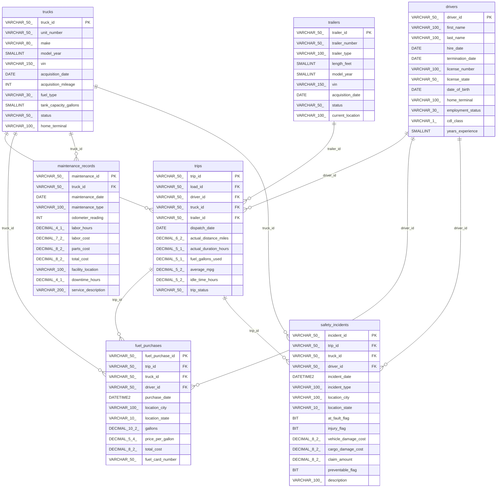

# Silver ERD — Fleet, Cost & Safety

Driver and vehicle assignments, fuel purchases, maintenance activity, and safety incidents.

**Schema:** `silver` · **Source of truth:** [`ddl_silver.sql`](../../scripts/silver/ddl_silver.sql)

This focused view is separated from the full 14-table ERD to make table definitions and relationships easier to inspect. It does not change the implemented schema.

**Key notation:** `PK` = primary key; `FK` = foreign key. Composite primary-key columns are each marked `PK`. Relationship lines represent the declared foreign-key constraints; consult the DDL for exact nullability and constraint definitions.
