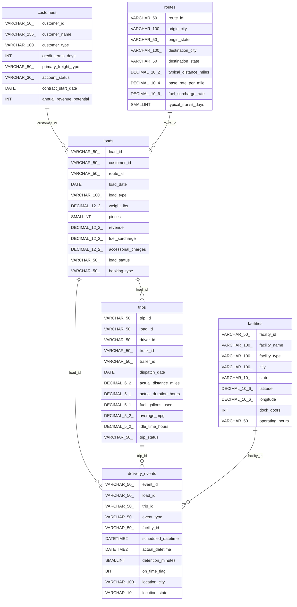

# Silver ERD — Operational Flow

Customer and route master data through loads, trips, delivery events, and facility references.

**Schema:** `silver` · **Source of truth:** [`ddl_silver.sql`](../../scripts/silver/ddl_silver.sql)

This focused view is separated from the full 14-table ERD to make table definitions and relationships easier to inspect. It does not change the implemented schema.

**Relationship note:** The diagram uses one-to-many notation for declared foreign-key relationships. Nullable foreign keys remain optional on the child side; consult the DDL for exact nullability and constraint definitions.
