# Gold Layer — Reporting Views

## 1. Purpose

The Gold reporting views provide business-focused analytical datasets on top of the Gold dimensional model. They expose operational and financial measures alongside relevant descriptive attributes, date information, and assignment indicators.

Each view is designed around a defined reporting grain. Dimension joins and aggregation strategies are selected to preserve that grain and prevent measure duplication.

The eight views support analysis of revenue, delivery performance, fleet and driver activity, customer performance, fuel purchasing, maintenance, safety, and truck-level recorded cost comparisons.

## 2. Gold reporting architecture

The diagram below shows the actual Gold tables used by each reporting view. A connection indicates that the view reads from that table; it does not imply a direct relationship between every table in the diagram.

```mermaid
flowchart TB
    subgraph DIM["Gold dimensions"]
        DD["dim_date"]
        DC["dim_customer"]
        DR["dim_route"]
        DF["dim_facility"]
        DT["dim_truck"]
        DDR["dim_driver"]
        DTR["dim_trailer"]
    end

    subgraph FACT["Gold facts"]
        FL["fact_loads"]
        FDE["fact_delivery_events"]
        FT["fact_trips"]
        FFP["fact_fuel_purchases"]
        FMR["fact_maintenance_records"]
        FSI["fact_safety_incidents"]
    end

    subgraph VIEWS["Gold reporting views"]
        VR["vw_revenue_performance"]
        VD["vw_delivery_performance"]
        VF["vw_fleet_performance"]
        VC["vw_customer_performance"]
        VFuel["vw_fuel_cost_analysis"]
        VM["vw_maintenance_performance"]
        VS["vw_safety_performance"]
        VTC["vw_truck_cost_efficiency"]
    end

    FL --> VR
    DD --> VR
    DC --> VR
    DR --> VR

    FDE --> VD
    DD --> VD
    DF --> VD

    FT --> VF
    DD --> VF
    DT --> VF
    DDR --> VF
    DTR --> VF

    FL --> VC
    DC --> VC
    DD --> VC

    FFP --> VFuel
    DD --> VFuel
    DT --> VFuel
    DDR --> VFuel

    FMR --> VM
    DD --> VM
    DT --> VM

    FSI --> VS
    DD --> VS
    DT --> VS
    DDR --> VS

    FT --> VTC
    FFP --> VTC
    FMR --> VTC
    DD --> VTC
    DT --> VTC

    classDef dimension fill:#e8f1fb,stroke:#4779a8,color:#17324d
    classDef fact fill:#fff0d9,stroke:#b98232,color:#50340b
    classDef view fill:#e7f4e9,stroke:#54865b,color:#1f4325
    class DD,DC,DR,DF,DT,DDR,DTR dimension
    class FL,FDE,FT,FFP,FMR,FSI fact
    class VR,VD,VF,VC,VFuel,VM,VS,VTC view
```

**How to read the diagram**

- Blue nodes represent Gold dimensions.
- Amber nodes represent Gold facts.
- Green nodes represent reporting views.
- The arrows show which Gold tables each view reads.
- `dim_date` can be used in multiple date roles within a view. For example, delivery performance uses separate scheduled-date and actual-date joins.
- `vw_customer_performance` aggregates load facts by customer before joining customer attributes; its date joins provide contract-start and first-observed-load calendar attributes.
- `vw_truck_cost_efficiency` independently aggregates three fact tables by truck before combining their results.

The reporting views sit above, rather than replace, the Gold dimensional model. Power BI and downstream analytical queries can consume the views or, where appropriate, the underlying Gold tables.

## 3. Gold model inventory

### 3.1 Dimension tables

| Dimension | Purpose |
|---|---|
| `dim_customer` | Customer identity and descriptive attributes |
| `dim_date` | Calendar and reporting-period attributes |
| `dim_driver` | Driver identity and descriptive attributes |
| `dim_facility` | Facility identity and location attributes |
| `dim_route` | Route identity, endpoints, and typical distance |
| `dim_trailer` | Trailer identity and descriptive attributes |
| `dim_truck` | Truck identity and descriptive attributes |

### 3.2 Fact tables and their grains

| Fact table | Grain |
|---|---|
| `fact_loads` | One row per load |
| `fact_trips` | One row per trip |
| `fact_delivery_events` | One row per delivery event |
| `fact_fuel_purchases` | One row per fuel purchase |
| `fact_maintenance_records` | One row per maintenance record |
| `fact_safety_incidents` | One row per safety incident |

## 4. Reporting views overview

The eight views serve different analytical purposes and do not share one common grain.

| Reporting view | Primary fact source | Reporting grain | Main analytical focus |
|---|---|---|---|
| `vw_revenue_performance` | `fact_loads` | One row per load | Reported revenue, load characteristics, customer and route performance |
| `vw_delivery_performance` | `fact_delivery_events` | One row per event | Pickup and delivery activity, on-time delivery, detention |
| `vw_fleet_performance` | `fact_trips` | One row per trip | Trip activity, distance, fuel consumption, MPG, idle time |
| `vw_customer_performance` | `fact_loads` aggregated by customer | One row per customer | Customer activity, reported revenue contribution, customer-type comparisons |
| `vw_fuel_cost_analysis` | `fact_fuel_purchases` | One row per fuel purchase | Purchased gallons, recorded fuel cost, unit prices, assignment analysis |
| `vw_maintenance_performance` | `fact_maintenance_records` | One row per maintenance record | Maintenance activity, recorded costs, labor, downtime |
| `vw_safety_performance` | `fact_safety_incidents` | One row per incident | Incident classifications, injuries, preventability, recorded damage and claims |
| `vw_truck_cost_efficiency` | Trips, fuel purchases, and maintenance facts independently aggregated | One row per truck | Truck-level activity, recorded spend and descriptive efficiency comparisons |

**Grain matters:** a load, trip, delivery event, purchase, maintenance record, incident, customer, and truck represent different business entities and levels of detail. Measures from different grains must not be combined without a deliberate aggregation strategy.

## 5. Individual reporting views

### 5.1 Revenue Performance

**SQL script:** [`vw_revenue_performance.sql`](../../scripts/gold/views/vw_revenue_performance.sql)

**Purpose:** Provide a load-level dataset for analysing reported load revenue, load characteristics, customer attributes, and route performance.

**Grain:** One row per load (`load_id`).

**Source and relationships:**
- `fact_loads` is the primary fact source.
- `dim_date` is an INNER JOIN using `load_date_key`.
- `dim_customer` and `dim_route` are LEFT JOINs.

The date relationship is mandatory. Customer and route assignments are optional, so their LEFT JOINs preserve loads with missing dimension assignments.

**Measures and attributes:** reported load revenue, fuel surcharge, accessorial charges, weight, pieces, load type, load status, booking type, customer attributes, route endpoints, typical distance, base rate, and calendar attributes.

**Included analyses:**
1. Monthly reported load revenue trend
2. Route performance
3. Booking type performance
4. Load type performance
5. Reported revenue per typical route mile

**Business definitions and limitations:**
- Reported Load Revenue is based on `fact_loads.revenue`.
- Fuel surcharge and accessorial charges remain separate measures. The source accounting definition does not establish whether these are already included in reported revenue. Do not add them to reported revenue and label the result total revenue.
- Revenue per typical route mile is a comparison proxy. It uses route-level typical distance, not the actual distance travelled by each individual load.
- Source currency has not been confirmed.

### 5.2 Delivery Performance

**SQL script:** [`vw_delivery_performance.sql`](../../scripts/gold/views/vw_delivery_performance.sql)

**Purpose:** Provide an event-level dataset for pickup and delivery analysis, with additive indicators for calculating delivery-only KPIs.

**Grain:** One row per event (`event_id`).

**Source and relationships:**
- `fact_delivery_events` is the primary fact source.
- `dim_date` is joined twice, in separate scheduled-date and actual-date roles, using mandatory date keys.
- `dim_facility` is an optional LEFT JOIN.

Event-reported city and state are retained separately from facility master location attributes. They are not assumed to describe the same location.

**Measures and attributes:** event type, scheduled and actual timestamps, detention minutes, on-time flag, scheduled and actual date attributes, facility attributes, event-reported location, and additive delivery KPI indicators.

**Included analyses:**
1. Overall delivery KPI
2. Annual delivery trend
3. Monthly on-time delivery trend

**Approved KPI definition:**

`On-Time Delivery Rate = On-Time Delivery Events / All Delivery Events × 100`

Only events where `event_type = 'Delivery'` contribute to this KPI. Pickup events remain available for separate operational analysis. The denominator includes all Delivery events, and missing on-time flags are not counted as on-time.

**Business findings and limitations:**
- The observed overall on-time delivery rate is 44.61%.
- Complete annual results are approximately 44.6% for 2022, 2023, and 2024.
- January 2025 contains 86 Delivery events and is a partial period.
- An earlier investigation observed an association between detention minutes and on-time status around an approximate ±120-minute window. This is not proof of causation or an approved business threshold.

### 5.3 Fleet Performance

**SQL script:** [`vw_fleet_performance.sql`](../../scripts/gold/views/vw_fleet_performance.sql)

**Purpose:** Provide a trip-level dataset for analysing fleet activity, distance, fuel consumption, fuel efficiency, and idle time.

**Grain:** One row per trip (`trip_id`).

**Source and relationships:**
- `fact_trips` is the primary fact source.
- `dim_date` is an INNER JOIN using dispatch date.
- `dim_truck`, `dim_driver`, and `dim_trailer` are LEFT JOINs.

Optional assignments are retained without dropping trips.

**Measures and attributes:** trip count, actual distance, trip fuel consumed, recorded trip MPG, idle hours, trip status, truck/driver/trailer attributes, assignment indicators, and dispatch-date attributes.

**Included analyses:**
1. Overall fleet performance
2. Truck-level performance
3. Annual fleet activity trend
4. Driver-level productivity

**Approved business definitions:**
- Weighted Fleet MPG = total actual distance / total trip fuel consumed.
- Average Trip MPG is the simple average of recorded trip-level MPG values. It is different from weighted fleet MPG.

**Business findings and limitations:**
- The dataset contains 85,410 trips.
- A total of 1,672 trips have no truck assignment. Unassigned trips remain in overall fleet totals but are excluded from truck-level rankings.
- Trip fuel consumed is not the same as fuel purchased.
- The source does not provide a reliable vehicle availability denominator, so true fleet utilization cannot be calculated.
- Truck, driver, and trailer descriptive attributes reflect current Type 1 dimension records, not historical snapshots.
- No route relationship is added because `fact_trips` has no `route_key`.

### 5.4 Customer Performance

**SQL script:** [`vw_customer_performance.sql`](../../scripts/gold/views/vw_customer_performance.sql)

**Purpose:** Provide a customer-level dataset for analysing customer activity, reported load revenue, revenue contribution, and customer-type performance.

**Grain:** One row per customer (`customer_id`).

**Source and relationships:**
- `fact_loads` is first aggregated by `customer_key`.
- The aggregated result is LEFT JOINed to `dim_customer`.
- `dim_date` is joined separately for contract-start and first-observed-load dates.

Aggregating the load fact before joining to the customer dimension preserves customer grain. The LEFT JOIN retains customers without load activity.

**Measures and attributes:** customer load count, reported load revenue, fuel surcharge, accessorial charges, average reported revenue per load, reported revenue contribution percentage, revenue rank, customer profile, contract start date, and first observed load date.

**Included analyses:**
1. Overall customer performance
2. Customer type performance
3. Top 20 customers by reported load revenue

**Business findings and limitations:**
- The Gold customer dimension contains 200 customers; all 200 have recorded load activity in the observed dataset.
- All 85,410 loads are assigned to a customer.
- Customer identity must use `customer_id`, not customer name alone, because repeated names exist.
- First Observed Load Date means the earliest load date available in the dataset. It is not a verified customer acquisition date.
- Customer attributes reflect current Type 1 dimension records.
- Load history begins on 2022-01-01, while contract dates extend back to 2020.
- Source currency has not been confirmed.

### 5.5 Fuel Cost Analysis

**SQL script:** [`vw_fuel_cost_analysis.sql`](../../scripts/gold/views/vw_fuel_cost_analysis.sql)

**Purpose:** Provide a purchase-level dataset for analysing fuel purchasing activity, recorded fuel costs, unit prices, and truck/driver assignment.

**Grain:** One row per fuel purchase (`fuel_purchase_id`).

**Source and relationships:**
- `fact_fuel_purchases` is the primary fact source.
- `dim_date` is an INNER JOIN using purchase date.
- `dim_truck` and `dim_driver` are LEFT JOINs.

Missing truck or driver assignments do not remove purchases from the view.

**Measures and attributes:** purchase count, gallons purchased, recorded fuel cost, recorded price per gallon, weighted recorded purchase cost per gallon, truck and driver attributes, assignment indicators, and purchase date/location attributes.

**Included analyses:**
1. Overall fuel purchase performance
2. Monthly fuel purchase trend
3. Truck-level fuel purchase summary
4. Driver-level fuel purchase summary
5. Truck/driver assignment breakdown

**Approved business definition:**

Weighted Average Recorded Cost per Gallon = sum of recorded fuel cost / sum of gallons purchased.

This differs from the simple average of individual purchase prices.

**Business findings and limitations:**
- Use recorded `total_cost` rather than recalculating it from gallons and price per gallon. An earlier investigation identified 2,478 records with a one-cent difference after recalculation and rounding.
- There are 3,880 purchases without truck assignment and 3,988 without driver assignment. These remain in overall totals.
- January 2025 contains 201 purchases and is a partial period.
- Fuel purchased must not be treated as fuel consumed on trips or evidence of fuel loss or wastage.
- Source currency has not been confirmed.

### 5.6 Maintenance Performance

**SQL script:** [`vw_maintenance_performance.sql`](../../scripts/gold/views/vw_maintenance_performance.sql)

**Purpose:** Provide a maintenance-record dataset for analysing maintenance activity, recorded costs, labor, downtime, truck attribution, and date trends.

**Grain:** One row per maintenance record (`maintenance_id`).

**Source and relationships:**
- `fact_maintenance_records` is the primary fact source.
- `dim_date` is an INNER JOIN using maintenance date.
- `dim_truck` is an optional LEFT JOIN.

**Measures and attributes:** maintenance record count, maintenance type, labor hours, labor cost, parts cost, recorded maintenance cost, downtime hours, truck attributes, maintenance date attributes, and facility-location text.

**Included analyses:**
1. Overall maintenance summary
2. Monthly maintenance trend
3. Maintenance type analysis
4. Truck-level maintenance summary
5. Maintenance location summary

**Business definitions and limitations:**
- Recorded Maintenance Cost uses source `total_cost`.
- Labor and parts costs remain separate component measures; do not add them again to recorded total cost.
- `facility_location` is source-reported text, not a `facility_id`. It must not be joined to `dim_facility`.
- Summed downtime is not equivalent to fleet unavailability.
- All 2,920 maintenance records in the observed data have truck assignments.
- Source currency has not been confirmed.

### 5.7 Safety Performance

**SQL script:** [`vw_safety_performance.sql`](../../scripts/gold/views/vw_safety_performance.sql)

**Purpose:** Provide an incident-level dataset for analysing safety classifications, responsibility, injuries, preventability, recorded damage, claims, and time trends.

**Grain:** One row per safety incident (`incident_id`).

**Source and relationships:**
- `fact_safety_incidents` is the primary fact source.
- `dim_date` is an INNER JOIN using incident date.
- `dim_truck` and `dim_driver` are optional LEFT JOINs.

Incident city and state remain source-reported text, not a facility relationship.

**Measures and attributes:** incident count, at-fault/injury/preventable flags and known-value indicators, corresponding incident counts, vehicle damage cost, cargo damage cost, claim amount, truck/driver assignment indicators, and incident date/classification attributes.

**Included analyses:**
1. Overall safety summary
2. Annual safety trend
3. Incident type analysis
4. Truck-level safety summary
5. Driver-level safety summary
6. Incident location summary

**Business definitions and limitations:**
- NULL safety flags represent unknown values, not FALSE.
- Rates must use the known-value count for the relevant flag as their denominator.
- `claim_amount` is the recorded claim measure. Vehicle and cargo damage amounts remain separate breakdown measures and must not be added again to claim amount.
- Truck and driver assignments are optional.
- Raw incident counts should not be used as individual driver or truck performance rankings without corresponding exposure denominators.
- Source currency has not been confirmed.
- The observed data contains 170 incidents, covering 2022–2024.

### 5.8 Truck Cost Efficiency

**SQL script:** [`vw_truck_cost_efficiency.sql`](../../scripts/gold/views/vw_truck_cost_efficiency.sql)

**Purpose:** Combine truck-level trip, fuel purchase, and maintenance measures for comparable reporting periods.

**Grain:** One row per truck in `dim_truck`.

**Reporting period:** Calendar years 2022–2024 inclusive.

**Source and aggregation design:**

The view uses three independent fact aggregations:
- `fact_trips`, grouped by `truck_key`
- `fact_fuel_purchases`, grouped by `truck_key`
- `fact_maintenance_records`, grouped by `truck_key`

Each fact is filtered to the reporting period and independently aggregated before its results are joined to `dim_truck`.

All trucks are retained, including trucks without activity in one or more fact tables. Unassigned fact records are excluded from truck-level attribution and must be reconciled separately.

**Measures and attributes:** trip count, actual distance, trip fuel consumed, weighted truck MPG, average recorded trip MPG, average idle hours per trip, fuel purchase count, gallons purchased, recorded fuel cost, weighted recorded purchase cost per gallon, maintenance record count, recorded maintenance cost, labor and parts cost, downtime, combined recorded fuel and maintenance cost, and combined recorded spend per actual mile proxy.

**Included analyses:**
1. Overall truck-level summary
2. Truck-level cost and efficiency comparison
3. Truck assignment coverage in the reporting period

**Why independent fact aggregation matters:**

The trip, fuel purchase, and maintenance fact tables have different grains. Directly joining their raw rows by truck can create fact-to-fact fanout: multiple records from one fact can match multiple records from another, multiplying rows and inflating sums.

The implemented design prevents this by:
1. Aggregating each fact independently by `truck_key`.
2. Joining the aggregated results to the unique truck dimension.
3. Preserving one output row per truck.

**Business definitions and limitations:**
- Trip fuel consumed and purchased fuel gallons are separate measures.
- Recorded fuel cost uses `fact_fuel_purchases.total_cost`.
- Recorded maintenance cost uses `fact_maintenance_records.total_cost`.
- Combined recorded spend is recorded fuel purchase cost plus recorded maintenance cost.
- Combined recorded spend per actual mile is a descriptive proxy, not true operating cost per mile or profitability.
- Purchase and maintenance timing may not correspond exactly to trips occurring in the same calendar period.
- Trucks without trip distance can have recorded spend but no valid spend-per-mile proxy.
- Truck attributes reflect current Type 1 dimension records.
- Source currency has not been confirmed.

## 6. Reporting period and data coverage

The reporting periods below reflect the observed data and implemented SQL filters. The views do not all have identical coverage.

| Reporting view | Observed reporting coverage | Qualification |
|---|---|---|
| Revenue Performance | Jan 2022 – Dec 2024 | 36 complete calendar months |
| Delivery Performance | Jan 2022 – Jan 2025 | January 2025 is partial |
| Fleet Performance | Jan 2022 – Dec 2024 | 36 complete calendar months |
| Customer Performance | Load activity: Jan 2022 – Dec 2024 | Contract dates extend earlier; earliest observed load is limited by available history |
| Fuel Cost Analysis | Jan 2022 – Jan 2025 | January 2025 is partial |
| Maintenance Performance | Jan 2022 – Dec 2024 | 36 complete calendar months |
| Safety Performance | Jan 2022 – Dec 2024 | Three calendar years |
| Truck Cost Efficiency | Jan 2022 – Dec 2024 | Explicitly filtered to calendar years 2022–2024 |

**Partial-period rule:** January 2025 delivery and fuel activity must not be compared with complete months or years as though it represented a full reporting period.

## 7. Validation approach

Each reporting view script contains validation checks executed against the created view. The checks are designed around the view's intended grain and source relationships.

| View | Main validation checks |
|---|---|
| Revenue Performance | Fact-to-view row count, one row per load, reconciliation of reported revenue, fuel surcharge, and accessorial charges |
| Delivery Performance | Fact-to-view row count, one row per event, reconciliation of event and delivery KPI indicators |
| Fleet Performance | Fact-to-view row count, one row per trip, reconciliation of trip measures and truck assignment indicators |
| Customer Performance | Row count against customer dimension, one row per customer, reconciliation of load counts, customer assignments, and financial measures |
| Fuel Cost Analysis | Fact-to-view row count, one row per purchase, reconciliation of purchase measures and assignment indicators |
| Maintenance Performance | Fact-to-view row count, one row per maintenance record, reconciliation of recorded maintenance measures |
| Safety Performance | Fact-to-view row count, one row per incident, reconciliation of incident classifications and financial measures |
| Truck Cost Efficiency | Row count against truck dimension, one row per truck, independent reconciliation of trip, fuel purchase, and maintenance measures by truck |

These checks establish that the reporting views preserve their intended row grain and selected source measures. They do not independently prove that every source value or business definition is intrinsically correct.

The wider Gold validation record also documents primary-key and foreign-key structure, orphan checks, enabled/trusted status, fact business-key uniqueness, Silver-to-Gold fact row-count reconciliation, and selected Silver-to-Gold measure reconciliation.

See [Gold Validation](gold_validation.md) for the evidence and scope of those checks.

## 8. Reporting and Power BI guidance

The views provide subject-specific reporting datasets for Power BI models and downstream analytical queries.

| Analytical subject | Recommended view |
|---|---|
| Load revenue and route comparisons | `vw_revenue_performance` |
| On-time delivery and detention | `vw_delivery_performance` |
| Trip activity and fleet fuel efficiency | `vw_fleet_performance` |
| Customer revenue and activity | `vw_customer_performance` |
| Fuel purchase costs and assignment | `vw_fuel_cost_analysis` |
| Maintenance costs and downtime | `vw_maintenance_performance` |
| Safety incident analysis | `vw_safety_performance` |
| Truck-level combined recorded spend | `vw_truck_cost_efficiency` |

### 8.1 Grain and aggregation precautions

- Understand the grain of a view before aggregating its measures.
- Do not directly join reporting views at different grains and assume the resulting measures remain additive.
- Avoid joining raw fact tables together without first controlling their relationship and aggregation grain.
- Use `vw_truck_cost_efficiency` for the implemented truck-level comparison of trip, fuel purchase, and maintenance measures.
- Keep purchased fuel and trip fuel consumption separate.
- Keep reported revenue, fuel surcharge, and accessorial charges separate.
- Preserve unknown safety flags as unknown.
- Treat partial January 2025 data separately from complete reporting periods.

### 8.2 Currency and financial interpretation

The source data does not establish a confirmed currency. Financial amounts are therefore presented without a currency symbol or currency name.

Recorded costs and revenue fields should retain their approved definitions. Do not infer profitability, all-in revenue, or true operating cost per mile from measures that do not establish those business definitions.

## 9. Related project documentation

| Document or script | Description |
|---|---|
| [Gold Data Dictionary](gold_data_dictionary.md) | Gold table structures, columns, and dimensional mappings |
| [Gold Validation](gold_validation.md) | Structural, relationship, fact-grain, and reconciliation evidence |
| [Gold Relationship Investigations](gold_relationship_investigations.md) | Relationship findings and modelling decisions |
| [Gold KPI Investigations](gold_kpi_investigations.md) | KPI definitions, investigation results, and business limitations |
| [Gold DDL](../../scripts/gold/ddl_gold.sql) | Gold dimension and fact table definitions |
| [Gold Load Script](../../scripts/gold/load_gold.sql) | Gold full-refresh loading implementation |
| [Gold Validation SQL](../../scripts/gold/validate_gold.sql) | Gold structural and fact validation queries |
| [Gold Measure Reconciliation SQL](../../scripts/gold/reconcile_gold_measures.sql) | Selected Silver-to-Gold measure reconciliation |
| [Gold Reporting View Scripts](../../scripts/gold/views/) | SQL definitions, validation checks, and analysis queries for the eight reporting views |

## 10. Documentation maintenance

This document describes the implemented SQL reporting views and their approved business definitions.

When a reporting view changes:
1. Review its SQL definition and validation checks.
2. Confirm that the documented grain and source relationships remain accurate.
3. Update measures, business rules, and reporting-period qualifications where required.
4. Reconcile changed outputs before updating reported findings.
5. Keep related Gold documentation consistent.

Additional visuals, including view-specific grain illustrations, fanout prevention, and reporting coverage, can be added to this document after they have been reviewed against the SQL implementation.
