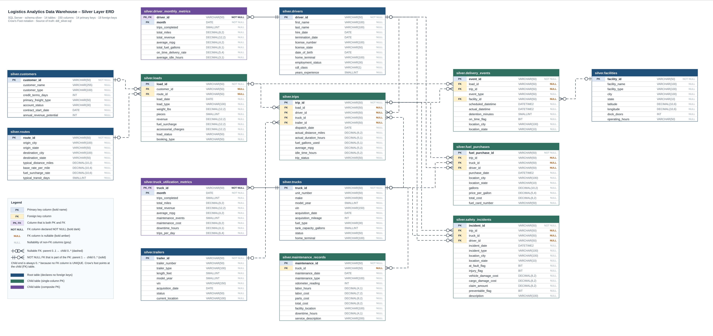

# Silver Layer — Logistics Analytics Data Warehouse

## 1. Overview

The Silver layer is the cleaned, standardized, and relationally structured layer of the Logistics Analytics Data Warehouse. It transforms the raw VARCHAR values ingested into Bronze into typed SQL Server tables while preserving the source entities and their original record grain.

Silver provides a reliable foundation for downstream analytical modelling in the Gold layer. Its responsibilities are structural integrity, consistent data types, controlled NULL handling, and referential integrity. It does not introduce unverified business calculations or change the grain of the source entities.

### Implementation summary

| Metric | Result |
|---|---:|
| Source layer | Bronze |
| Target layer | Silver |
| Source tables | 14 |
| Silver tables | 14 |
| Rows loaded | 549,706 |
| Primary keys | 14 |
| Foreign keys | 18 |
| Composite primary keys | 2 |
| Loading strategy | Full refresh |
| Loading approach | Transactional stored procedure |

**Database:** LogisticsAnalytics  
**Schema:** silver

## 2. Position in the Medallion Architecture

The project separates raw ingestion, standardized data preparation, and analytical modelling:

| Layer | Responsibility | Status |
|---|---|---|
| Bronze | Ingest and preserve source data in its raw VARCHAR representation | Implemented |
| Silver | Convert, standardize, and relate source entities using typed relational tables | Implemented |
| Gold | Prepare business-focused analytical models for reporting | Next stage |

The Bronze layer preserves source values for traceability and investigation. Silver applies the approved structural and data-type decisions. Gold will build on the validated Silver entities to support analytical use cases.

See the [Bronze layer documentation](../bronze/readme.md) for the ingestion and profiling process.

## 3. Silver Data Model

Silver contains 14 tables. The table structures preserve the source entity grain, with primary and foreign keys defining the implemented relational model.

### 3.1 Entity Relationship Diagram (ERD)\n\nThe diagram below documents the implemented Silver relational schema. It includes all 14 tables and 150 columns, with SQL data types, nullability, primary-key and foreign-key markers, and the 18 declared foreign-key relationships. The two monthly metric tables show their composite primary keys.\n\n\n\n- [Open the editable Draw.io source](../diagrams/silver_erd.drawio)\n\nThe ERD is generated from and should be maintained against [ddl_silver.sql](../../scripts/silver/ddl_silver.sql). The DDL remains the authoritative implementation; the diagram is its visual documentation.\n\n### 3.2 Table inventory

| Table | Grain | Rows loaded |
|---|---|---:|
| **customers** | One row per customer | 200 |
| **drivers** | One row per driver | 150 |
| **facilities** | One row per facility | 50 |
| **routes** | One row per route | 58 |
| **trucks** | One row per truck | 120 |
| **trailers** | One row per trailer | 180 |
| **loads** | One row per load | 85,410 |
| **trips** | One row per trip | 85,410 |
| **fuel_purchases** | One row per fuel purchase | 196,442 |
| **maintenance_records** | One row per maintenance record | 2,920 |
| **delivery_events** | One row per delivery event | 170,820 |
| **safety_incidents** | One row per safety incident | 170 |
| **driver_monthly_metrics** | One row per driver per reporting month | 4,464 |
| **truck_utilization_metrics** | One row per truck per reporting month | 3,312 |
| **Total** | **14 tables** | **549,706** |

### 3.3 Primary keys

Every Silver table has a primary key. Twelve tables use a single-column primary key; the two monthly metric tables use composite primary keys.

| Table | Primary key |
|---|---|
| customers | customer_id |
| drivers | driver_id |
| facilities | facility_id |
| routes | route_id |
| trucks | truck_id |
| trailers | trailer_id |
| loads | load_id |
| trips | trip_id |
| fuel_purchases | fuel_purchase_id |
| maintenance_records | maintenance_id |
| delivery_events | event_id |
| safety_incidents | incident_id |
| driver_monthly_metrics | driver_id, month |
| truck_utilization_metrics | truck_id, month |

The composite keys enforce the intended monthly grain: one record per driver/month and one record per truck/month.

### 3.4 Foreign-key relationships

The Silver DDL defines 18 foreign-key relationships. All 18 foreign keys are enabled and trusted. Nullable foreign keys preserve the source model's optional relationships.

| Child table and column | Parent table and column | Nullability |
|---|---|---|
| loads.customer_id | customers.customer_id | Nullable |
| loads.route_id | routes.route_id | Nullable |
| trips.load_id | loads.load_id | Nullable |
| trips.driver_id | drivers.driver_id | Nullable |
| trips.truck_id | trucks.truck_id | Nullable |
| trips.trailer_id | trailers.trailer_id | Nullable |
| fuel_purchases.trip_id | trips.trip_id | Nullable |
| fuel_purchases.truck_id | trucks.truck_id | Nullable |
| fuel_purchases.driver_id | drivers.driver_id | Nullable |
| maintenance_records.truck_id | trucks.truck_id | Nullable |
| delivery_events.load_id | loads.load_id | Nullable |
| delivery_events.trip_id | trips.trip_id | Nullable |
| delivery_events.facility_id | facilities.facility_id | Nullable |
| safety_incidents.trip_id | trips.trip_id | Nullable |
| safety_incidents.truck_id | trucks.truck_id | Nullable |
| safety_incidents.driver_id | drivers.driver_id | Nullable |
| driver_monthly_metrics.driver_id | drivers.driver_id | NOT NULL |
| truck_utilization_metrics.truck_id | trucks.truck_id | NOT NULL |

The DDL defines 14 primary-key constraints and 18 foreign-key constraints. It does not add separate UNIQUE or CHECK constraints.

## 4. Data Type and Schema Design

Bronze stores the imported source columns as VARCHAR. Silver assigns data types based on each column's role and the profiling and investigation work completed during the Bronze stage.

### 4.1 Identifiers

Identifiers remain character-based values, primarily VARCHAR(50), rather than being converted to numeric types. This preserves their identity and avoids treating identifiers as quantities or unintentionally removing leading zeros.

Primary-key identifiers are trimmed during loading. Foreign-key identifiers are trimmed, and blank values are converted to NULL where the relationship is nullable.

### 4.2 Dates and timestamps

- Calendar-date attributes use DATE.
- Event timestamps use DATETIME2.

Examples include trips.dispatch_date as DATE and the delivery-event, fuel-purchase, and safety-incident timestamps as DATETIME2.

### 4.3 Numeric and flag columns

Numeric columns use integer types or appropriately sized DECIMAL(p,s) definitions according to the expected values and required fractional precision. Boolean indicators use BIT.

The DDL explicitly defines the target type and precision for each field rather than relying on a generic numeric type.

### 4.4 Nullability and constraints

- Primary-key columns are NOT NULL.
- Non-primary-key nullability follows the approved source model.
- Nullable foreign keys remain nullable; missing optional relationships are not replaced with invented identifiers.
- Primary and foreign keys enforce uniqueness and referential integrity at the relational layer.

## 5. Bronze-to-Silver Transformation

The transformation is implemented through explicit, static INSERT...SELECT statements in silver.load_silver. Each target table has an explicit insert-column list and a corresponding source mapping. This makes the transformation visible and avoids relying on source column order or SELECT *.

### 5.1 Standardization and NULL handling

The procedure applies targeted trimming and blank handling:

- TRIM() removes leading and trailing ordinary spaces from identifiers and values being converted.
- NULLIF(TRIM(column), '') converts empty or space-only values to NULL.
- Nullable foreign-key values use the same blank-to-NULL handling so optional relationships remain NULL rather than becoming empty-string references.
- Descriptive text columns are generally passed through without broad text rewriting.

### 5.2 Explicit data type conversion

The procedure uses CONVERT() to map source VARCHAR values to their Silver target types. This makes the intended target type explicit in the loading logic.

The conversion approach is deliberately strict: a non-empty value that cannot be converted to its target type raises an error instead of silently being converted to NULL. Because the load is transactional, a failed conversion causes the batch to roll back.

### 5.3 Targeted mappings and approved decisions

| Silver target | Bronze source | Transformation or decision |
|---|---|---|
| trips.dispatch_date | trips.dispatch_date | Converted to DATE and checked against the source value. |
| truck_utilization_metrics.trips_per_day | truck_utilization_metrics.utilization_rate | Renamed in Silver and converted to DECIMAL(6,4). The source measure was investigated as average trips per calendar day, not a utilization percentage. |
| fuel_purchases.truck_id | fuel_purchases.truck_id | Blank values are normalized to NULL; the relationship remains nullable. |
| customers.annual_revenue_potential | customers.annual_revenue_potential | Uses the approved INT target type. |
| loads.accessorial_charges | loads.accessorial_charges | Zero values are preserved; they are not automatically treated as missing. |

The loading process does not deduplicate source entities or infer missing business relationships. For example, facilities with matching names or locations are not merged solely on that basis.

## 6. Silver Loading Process

The loading logic is implemented in [load_silver.sql](../../scripts/silver/load_silver.sql) as the stored procedure silver.load_silver.

### 6.1 Full-refresh strategy

The procedure uses a full refresh:

1. Existing Silver rows are deleted.
2. Bronze data is inserted into the Silver tables again.
3. The load is committed only after all 14 table inserts complete successfully.

The procedure deletes child tables before parent tables to respect foreign-key dependencies. It inserts parent tables before child tables so referenced records are available when dependent records are loaded.

This is a full reload, not an incremental or change-data-capture process.

### 6.2 Transaction and error handling

The procedure uses:

- SET NOCOUNT ON to suppress per-statement row-count messages.
- SET XACT_ABORT ON to make runtime errors abort the transaction.
- BEGIN TRANSACTION and COMMIT TRANSACTION to make the reload atomic.
- TRY...CATCH for error handling.
- XACT_STATE() to determine whether a transaction requires rollback.
- THROW to re-raise the original error after rollback.

If the load fails, the procedure rolls back the transaction so that a partially refreshed Silver layer is not left as the committed result.

### 6.3 Load monitoring

After each INSERT, the procedure captures @@ROWCOUNT immediately, reports the rows inserted for that table, and adds the count to a batch total. It also reports the total number of rows loaded and the elapsed duration.

In the successful validation run, the procedure loaded **549,706 rows across 14 tables**. The observed duration for that run was approximately **8 seconds**; this is an execution observation, not a performance guarantee.

### 6.4 Execution

The script creates or alters the procedure and includes an execution statement at the end. Review the script before running it because executing it also starts the full Silver refresh.

The database context should be LogisticsAnalytics.

## 7. Silver Validation

The Silver layer was validated after loading. The completed validation work covered six areas.

| # | Validation area | Scope | Result |
|---:|---|---|---|
| 1 | Row-count comparison | Compare all 14 Bronze and Silver tables | All 14 table counts matched; 549,706 rows in each layer |
| 2 | Primary-key validation | Check NULL key rows and duplicate key groups across 14 tables | 0 NULL key rows and 0 duplicate key groups |
| 3 | Foreign-key orphan validation | Check all 18 child-to-parent relationships | 0 orphan rows |
| 4 | Constraint status | Check all PK and FK constraints | 14 PKs enabled; 18 FKs enabled and trusted |
| 5 | Source-to-Silver PK reconciliation | Compare keys in both directions for all 14 tables, including composite keys | 0 issues across 28 reconciliation checks |
| 6 | Targeted transformation validation | Validate dispatch date, trips-per-day mapping, and fuel-purchase truck_id NULL handling | 0 mismatches across all 3 checks |

### 7.1 Row-count reconciliation

Every Silver table contained the same number of rows as its corresponding Bronze table after the successful load. The combined total was 549,706 rows in each layer.

### 7.2 Key and relationship integrity

The checks confirmed:

- No NULL primary-key values.
- No duplicate primary-key groups, including the two composite keys.
- No orphan values across the 18 foreign-key relationships when nullable foreign-key values were excluded.
- All 14 primary keys were enabled.
- All 18 foreign keys were enabled and trusted.

### 7.3 Source-to-Silver key reconciliation

A two-way comparison was performed between the transformed Bronze primary keys and Silver primary keys. The checks accounted for trimming and DATE conversion in the composite monthly keys. All 28 directional checks returned zero issues.

### 7.4 Targeted transformation checks

Three targeted checks returned zero mismatches:

1. trips.dispatch_date conversion.
2. Mapping Bronze utilization_rate to Silver trips_per_day.
3. Blank-to-NULL handling for fuel_purchases.truck_id.

These checks supplement row counts and key integrity checks. They do not claim that every non-key descriptive value has undergone a complete column-by-column reconciliation.

## 8. Repository Files

| File | Responsibility |
|---|---|
| [ddl_silver.sql](../../scripts/silver/ddl_silver.sql) | Creates the Silver schema and 14 typed table structures with primary and foreign keys. |
| [load_silver.sql](../../scripts/silver/load_silver.sql) | Defines and executes the full-refresh Bronze-to-Silver loading procedure. |

The Silver validation SQL is maintained separately from the loading scripts. The validation documentation above records the six completed checks and their execution results.

## 9. Scope and Limitations

The Silver layer establishes typed, relationally consistent data. It does not by itself resolve every business-definition question in the source dataset.

- The source grain is preserved; the loading procedure does not deduplicate records.
- Optional source relationships remain nullable where defined in the DDL.
- Zero values are retained unless a documented business rule establishes otherwise.
- Some source measures and descriptions may still require business-context interpretation before they are used in Gold calculations.
- The validation suite checks row counts, keys, foreign-key orphans, constraint state, key reconciliation, and selected transformations. It is not a full comparison of every non-key column between Bronze and Silver.
- The Silver ERD is documented in Section 3.1. A separate transformation-flow diagram may be added after the end-to-end Gold loading design is finalized.

## 10. Next Stage: Gold

With the Silver structures, loading process, and selected validation checks implemented, the next stage is to design Gold analytical models. Gold development should use the validated Silver entities as its source and apply documented business definitions for reporting metrics and analytical dimensions.

---

**Related project documentation**

- [Project overview](../../README.md)
- [Bronze layer documentation](../bronze/readme.md)
- [Silver table DDL](../../scripts/silver/ddl_silver.sql)
- [Silver loading procedure](../../scripts/silver/load_silver.sql)
